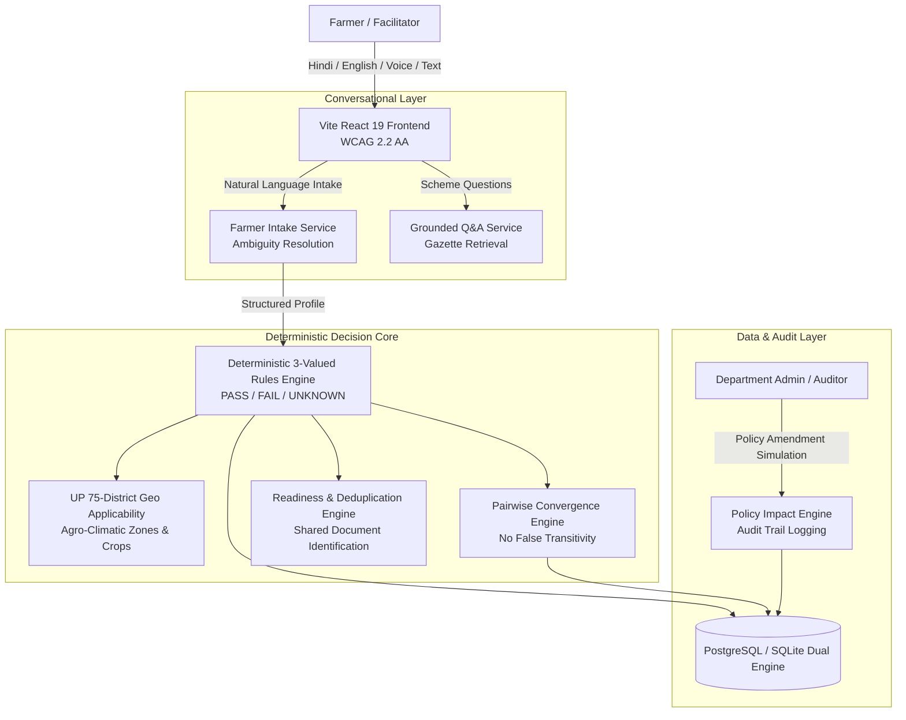

# YojanaSaathi AI — System Architecture & Engineering Blueprint

## 1. System Overview

**YojanaSaathi AI (योजना साथी AI)** is an Evidence-Grounded Farmer Benefit Intelligence and Multi-Scheme Convergence Platform engineered specifically for the 75 administrative districts of Uttar Pradesh, India.

Unlike conventional conversational chatbots that hallucinate entitlement conditions or provide probabilistic estimates, YojanaSaathi decouples conversational interaction from statutory decision-making:
- **Conversational Layer (NLP/Intake):** Conducts natural language intake, detects language (Hindi, English, Hinglish, Punjabi), extracts farm parameters, identifies missing details, resolves localized land unit ambiguities (e.g. Pucca vs. Kachha Bigha), and provides source-anchored explanations.
- **Deterministic Evaluation Layer (Core Engine):** Implements three-valued logic (`PASS`, `FAIL`, `UNKNOWN`) to independently evaluate statutory rules against farmer profiles.
- **Pairwise Convergence Engine:** Computes pairwise multi-scheme compatibility using direct statutory evidence without flawed transitive assumptions ($A \sim B \land B \sim C \not\implies A \sim C$).
- **Action Plan & Readiness Engine:** Deduplicates document requirements, groups shared proofs (e.g., Aadhaar, Khatauni ROR, Bank Passbook), and plots a 7-stage farmer benefit journey.

---

## 2. Core Architectural Principles

### 2.1 Deterministic Three-Valued Logic
Eligibility is never decided by an LLM. Every statutory condition evaluates to:
- **`PASS`**: The profile meets or exceeds statutory requirements.
- **`FAIL`**: The profile fails a mandatory condition (e.g. landholding > 2 Ha for marginal subsidy, or resident outside UP).
- **`UNKNOWN`**: Crucial data is missing or ambiguous (e.g. unverified landholding unit, missing crop selection, or pending land record verification). Missing information is **never** assumed to be `PASS`.

### 2.2 Pairwise Independent Convergence
Convergence relationships between schemes (e.g. PM-KISAN with KCC, or PMFBY with PMKSY) are evaluated strictly in pairs ($N \times (N-1) / 2$). No scheme relationship is inferred by transitivity. Each relationship must cite an official government document, circular, or guideline clause.

### 2.3 Transparent Multi-Factor Ranking
Recommended schemes are prioritized using an auditable formula:
$$\text{Score} = 0.40 \times \text{NeedRelevance} + 0.35 \times \text{EligibilityScore} + 0.10 \times \text{GeoRelevance} + 0.15 \times \text{FreshnessScore}$$
Crucially, relevance score **never** elevates a scheme whose mandatory conditions evaluate to `FAIL`.

### 2.4 Strict Non-Claimant Distinction
The system maintains an absolute distinction between:
- **Citizen Preparation & Navigation:** What YojanaSaathi does (identifying eligibility, missing documents, and directing to official portals).
- **Statutory Claim Approval:** What only designated government authorities (e.g., Tehsildar, Agriculture Officer, Bank Branch Manager) can execute.

---

## 3. Technology Stack & Directory Topology

- **Frontend:** React 19, TypeScript, Vite, Tailwind CSS, Lucide Icons, i18next (Hindi, English, Hinglish, Punjabi).
- **Backend:** FastAPI (Python 3.13), Pydantic v2, SQLAlchemy 2.0 ORM, Alembic migrations, Uvicorn ASGI server.
- **Database:** Dual-compatible engine supporting SQLite (zero-config hackathon execution) and PostgreSQL (production deployment with connection pooling).
- **Security:** Passlib (bcrypt/Argon2) password hashing, JWT access tokens (short TTL), family-based refresh token rotation with SHA-256 storage, Role-Based Access Control (RBAC).

---
*YojanaSaathi AI Engineering Team — Architecture Reference v3.0*

