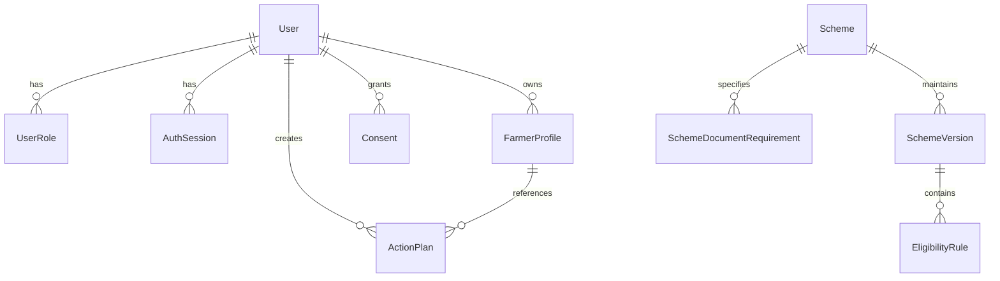

# YojanaSaathi AI — Database Schema & Data Architecture
**Document Version:** 3.0.0  
**Database Architect:** Database Architect & Senior Backend Engineer  
**Supported Dialects:** PostgreSQL 15+, SQLite 3.35+ (Dual-Support)

---

## 1. Entity Relationship Overview

The schema is normalized to 3NF, utilizing UUID string identifiers (36 characters) to eliminate integer enumeration enumeration risks and simplify distributed data synchronizations.

---

## 2. Table Specifications & Indexing Strategy

### 2.1 Identity & Access
- `users`: Stores user identity, normalized email (`UNIQUE`, index), bcrypt password hash, account status, and timestamps.
- `user_roles`: Maps `user_id` to role (`FARMER`, `ADMIN`, `FACILITATOR`) with composite unique constraint `(user_id, role)`.
- `auth_sessions`: Manages refresh token rotation families. Columns: `family_id` (index), `refresh_token_hash` (index, SHA-256), `expires_at`, `revoked_at`, `rotated_from_session_id`.

### 2.2 Citizen Profiles & Consent
- `farmer_profiles`: Captures district, landholding in acres (normalized float), category (`MARGINAL`, `SMALL`, `MEDIUM_LARGE`), primary crops, and irrigation source. Indexed on `user_id`.
- `consents`: Digital consent tracking with purpose, version, granted timestamp, and revoked timestamp.

### 2.3 Policy Evidence & Schemes
- `schemes`: Canonical scheme codes (`PM_KISAN`, `PMFBY`, `PMKSY_PDMC`, `KCC`, `UP_KRISHAK_DURGHATNA`, `SMAM_MACHINERY`), department, level, and official portal URL.
- `scheme_versions`: Tracks policy guideline versions (`version_number`, `status`, `verified_by`, `verified_at`, `source_url`, `source_section`).
- `eligibility_rules`: Statutory conditions linked to `scheme_version_id`. Attributes: `rule_code`, `field_name`, `operator`, `target_value`, `is_mandatory`, `source_citation`.
- `compatibility_rules`: Pairwise convergence rules. Attributes: `scheme_code_a` (index), `scheme_code_b` (index), `status` (`COMPATIBLE_CONFIRMED`, `UNKNOWN_REQUIRES_VERIFICATION`), `evidence_text`, `authoritative_source`, `verified_by`.
- `scheme_document_requirements`: Documents required per scheme with `document_category`, `is_mandatory`, and `accepted_formats`.

### 2.4 Action Plans & Auditing
- `action_plans`: Generated citizen plans. Columns: `plan_number` (`UNIQUE`, index), `selected_schemes_json`, `results_summary_json`, `checklist_items_json`, `created_at`.
- `audit_logs`: Immutable administrative audit trail capturing `user_id`, `action`, `resource_type`, `resource_id`, `metadata_json`, and `created_at`.

