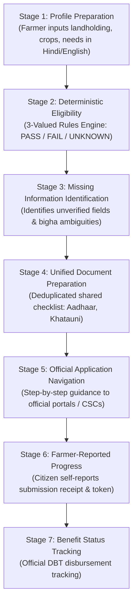

# YojanaSaathi AI — The 7-Stage Farmer Benefit Journey

**Document Version:** 3.0.0  
**Scope:** Transparent Farmer Onboarding, Deterministic Evaluation, and Post-Application Navigation

---

## 1. The 7-Stage Progressive Benefit Architecture

YojanaSaathi structures the farmer experience into 7 distinct, auditable stages that maintain complete transparency regarding who is responsible for each milestone:

---

## 2. Detailed Stage Breakdown

### Stage 1: Farmer Profile Preparation
- **Actor:** Farmer or Gram Panchayat Facilitator (CSC / VLE).
- **Modality:** Natural Language Voice/Text input in Hindi ("मेरे पास दो बीघा जमीन है और मैं गेहूं की खेती करता हूं...") or Step-by-Step Intake Wizard.
- **System Actions:** Detects language, extracts crops, detects district, parses land area, and flags local unit ambiguities (Pucca vs. Kachha Bigha).

### Stage 2: Deterministic Eligibility Assessment
- **Actor:** YojanaSaathi Deterministic Rules Engine (Zero LLM inference).
- **Outcomes:** Every statutory condition is evaluated independently to `PASS`, `FAIL`, or `UNKNOWN`.
- **Transparency:** Displays condition-by-condition citations, statutory minimums, and department names.

### Stage 3: Missing Information Identification
- **Actor:** System in dialogue with Farmer.
- **Purpose:** Highlights exactly why a scheme status is `NEEDS_MORE_INFO`.
- **Example:** If Khatauni land verification is unconfirmed, or if crop sowing certificate is absent, the system asks targeted follow-up questions instead of guessing.

### Stage 4: Unified Document Preparation & Deduplication
- **Actor:** Farmer preparing physical/digital papers.
- **Engine Function:** Groups statutory proofs across all chosen schemes.
- **Shared Documents:**
  - Aadhaar Card (Shared across all 6 schemes)
  - Khatauni Land Record (Shared across PM-KISAN, KCC, PMFBY, SMAM, Durghatna)
  - Bank Passbook with IFSC (Shared across all DBT schemes)
- **Interactive Checklist:** Farmer checks off items; progress updates dynamically.

### Stage 5: Official Application Navigation
- **Actor:** Farmer navigating external government endpoints.
- **Deliverable:** Live links and physical directions to official destinations:
  - PM-KISAN: [https://pmkisan.gov.in](https://pmkisan.gov.in)
  - PMFBY: [https://pmfby.gov.in](https://pmfby.gov.in)
  - PMKSY-PDMC: [https://uphorticulture.gov.in](https://uphorticulture.gov.in)
  - KCC: Local Commercial / RRB Branch / [https://fasalrin.gov.in](https://fasalrin.gov.in)
  - UP Krishak Durghatna: Tehsil SDM Office / [https://edistrict.up.gov.in](https://edistrict.up.gov.in)
  - SMAM Machinery: [https://agrimachinery.nic.in](https://agrimachinery.nic.in)

### Stage 6: Farmer-Reported Application Progress
- **Actor:** Citizen / Farmer.
- **Status Standard:** Explicitly marked `FARMER_REPORTED`.
- **Description:** Farmers enter their application reference number or token booking number. YojanaSaathi records this for tracking and reminder purposes without claiming sovereign government confirmation.

### Stage 7: Benefit Status Tracking & Verification
- **Actor:** Respective State/Central Government Department.
- **Status Standard:** Clearly marked `PENDING_STATUTORY_DISBURSEMENT`.
- **Disclaimer:** Benefit sanctioning and DBT transfers are executed solely by the Government of Uttar Pradesh and the Government of India through the Public Financial Management System (PFMS) and Aadhaar Payment Bridge (APB).

